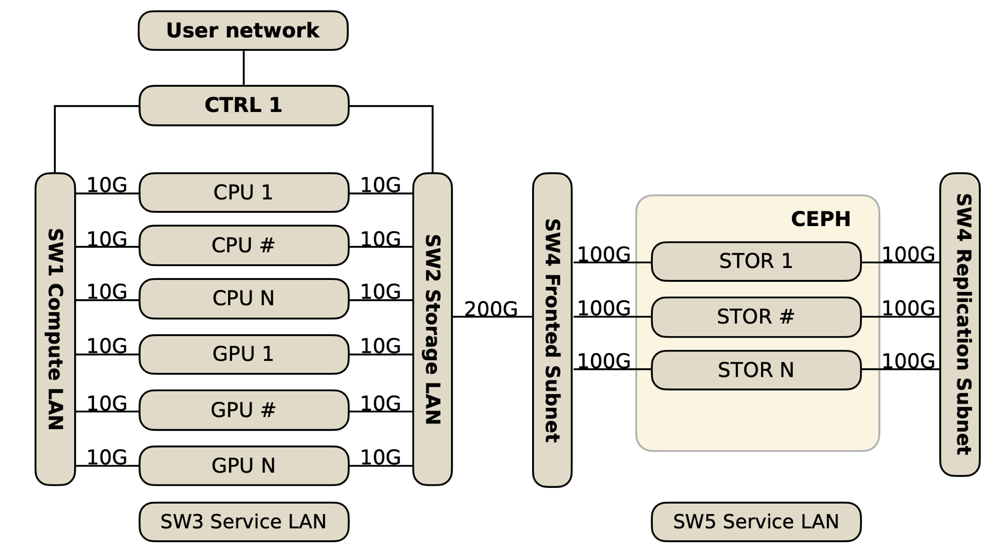

# Clúster Chuchunco

**Chuchunco** es el clúster de cómputo de alto rendimiento (HPC) del Departamento de Física de la Universidad de Santiago de Chile, operado por la plataforma **C3P** (Computación Científica y Procesamiento de Datos).

Financiado por el proyecto FONDEQUIP EQM230160 · abierto a la comunidad de investigación USACH y sus colaboradores.

!!! warning "Versión preliminar"
    Este sitio está en construcción. Las secciones marcadas con **«por confirmar»** pueden cambiar mientras terminamos la puesta en marcha.

## ¿Qué ofrece?

| Recurso | Nodos | Por nodo |
|---|---|---|
| CPU general (`CPU`) | 5 (`cpun1`–`cpun5`) | 2× AMD EPYC 9554 · 128 núcleos · 768 GB RAM |
| Alta memoria (`MEM`) | 1 (`high-ram-n1`) | 2× AMD EPYC 9654 · 192 núcleos · 1,5 TB RAM |
| GPU NVIDIA (`GPU`) | 2 (`gpun2`, `gpun3`) | 4× NVIDIA RTX 6000 Ada (48 GB) · 24 núcleos · 256 GB RAM |
| GPU AMD (`GPU`) | 1 (`gpun1`) | 2× AMD Instinct MI210 (64 GB) · 32 núcleos · 512 GB RAM |
| Almacenamiento | CEPH distribuido | ~1,2 PB brutos, montado en `/data` |

En total: **más de 900 núcleos de CPU, 10 GPUs y más de 6 TB de RAM**, administrados con el gestor de colas **Slurm** y con soporte nativo de contenedores (**Pyxis/Enroot**).

## Empieza aquí

-   :material-account-plus:{ .lg } **1 · Solicita una cuenta**

    ---
    Abre un proyecto o únete a uno.

    [:octicons-arrow-right-24: Solicitar](acceso/solicitar-cuenta.md)

-   :material-console:{ .lg } **2 · Conéctate**

    ---
    SSH desde la red USACH o por VPN.

    [:octicons-arrow-right-24: Conectarse](acceso/conectarse.md)

-   :material-play-circle:{ .lg } **3 · Lanza tu primer trabajo**

    ---
    Particiones, `sbatch` y ejemplos con Slurm.

    [:octicons-arrow-right-24: Primeros pasos](uso/slurm.md)

-   :material-book-check:{ .lg } **4 · Agradece y registra**

    ---
    Texto de agradecimiento y formulario de productos.

    [:octicons-arrow-right-24: Agradecimientos](agradecimientos.md)

